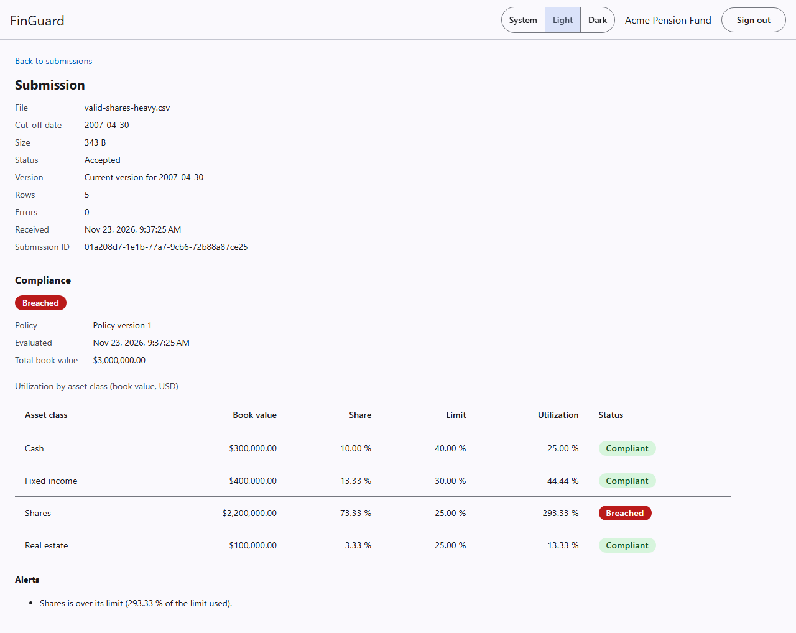
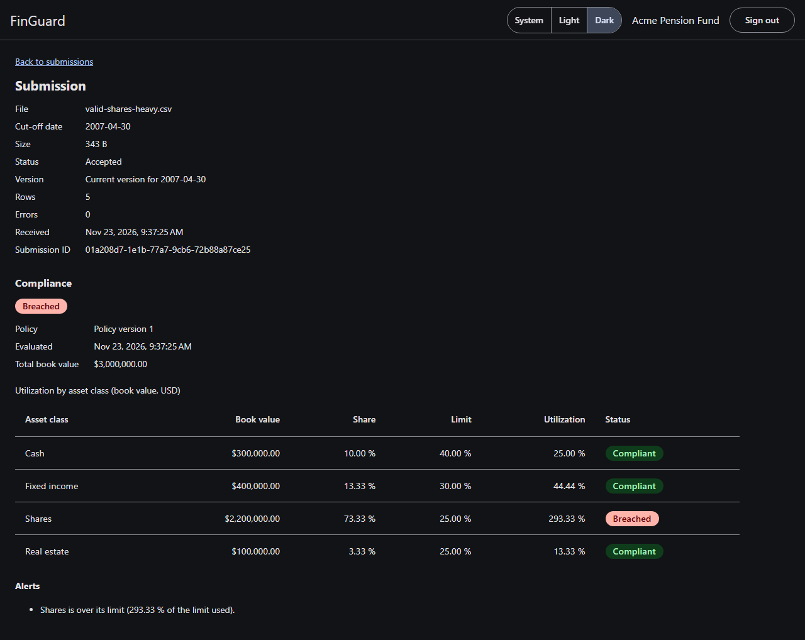
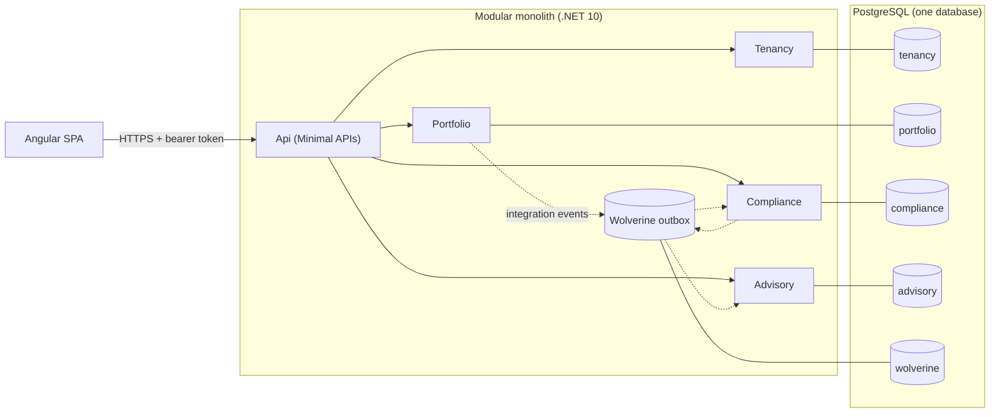

# FinGuard

An entity uploads a CSV with its investment portfolio at a cut-off date. FinGuard validates it, evaluates it against
global maximum-allocation limits per asset class (`cash`, `fixed_income`, `shares`, `real_estate`; all in USD) on
**book value** ([ADR-0010](docs/adr/0010-valuation-basis-book-value.md)), returns `compliant` / `warning` /
`breached`, raises alerts near the limits and produces a rebalancing advisory: a deterministic proposal explained by
an AI narrative. It is a portfolio project built local-first, at near-zero cost until the Azure phase.

## Status

| Phase | State | Scope |
| --- | --- | --- |
| 0 Foundations | ✓ Done | Solution skeleton, Aspire, PostgreSQL, module DbContexts, Wolverine outbox, CI |
| 1 Walking skeleton | ✓ Done | Development login, tenant resolution, Angular shell, file upload and submission history end to end |
| 2 Portfolio ingestion | ✓ Done | CSV validation, rejected files with errors, idempotent uploads, current submission per cut-off date, `SubmissionAccepted` event to Compliance |
| 3 Compliance | ✓ Done | Domain model and versioned global limit policy ([ADR-0012](docs/adr/0012-compliance-domain-model.md)), evaluation of every accepted submission with `EvaluationCompleted`, result API, result on the submission detail page, light and dark theme (one toolbar button; follows the operating system until you choose) |
| 4 Advisory | ✓ Done | Deterministic rebalance proposal ([ADR-0013](docs/adr/0013-rebalance-engine.md)) stored with every evaluation, in `EvaluationCompleted`, the API and the detail page. Template narrative for every evaluation, validated against its facts ([ADR-0014](docs/adr/0014-advisory-narrative.md)). Optional AI context paragraph from a local model, with no figures or statuses, shown only when it passes validation ([ADR-0015](docs/adr/0015-model-narrator.md)) |
| Pre-cloud hardening | ✓ Done | API under `/api/v1` with an OpenAPI document rendered by Scalar, paged and filtered submission history (Brief #20); rate limiting per tenant and per IP, forwarded headers behind the platform proxy, `xmin` row versioning on advisories ([ADR-0016](docs/adr/0016-request-protection.md), Brief #21) |
| 5 Azure | Planned | Container Apps, Static Web Apps, Entra External ID, Key Vault, observability |

Event flow today: an accepted upload publishes `SubmissionAccepted` (class totals) through the outbox in the same
transaction, and Compliance stores its own portfolio snapshot from it ([ADR-0011](docs/adr/0011-portfolio-compliance-integration-contract.md)).
Compliance then evaluates the snapshot against the limit policy in force at the cut-off date, stores the evaluation and
publishes `EvaluationCompleted` with its rebalance proposal; `GET /api/v1/compliance/submissions/{id}/evaluation` returns it.

The detail page of an accepted submission shows its compliance result: overall status, policy version, one row per
asset class (book value, share, limit, utilization, status), the alerts and the rebalancing proposal (current,
proposed and signed change per class that moves, with a totals row), followed by the Advisory section: a plain-text
narrative of the result. Screenshots from the sample data:

| Light | Dark |
| --- | --- |
|  |  |

How the AI context works ([ADR-0015](docs/adr/0015-model-narrator.md)): the template writes the whole narrative, every
figure and every status, and is never replaced, so the page never waits for a model. When the local model is switched
on (`dev-session.ps1 -StartAspire -WithAi`: Ollama in Aspire, `llama3.2:3b` by default), a separate step outside any
database transaction asks one Microsoft Agent Framework agent, with no tools, for one extra paragraph on the reasoning
behind the proposal. It sees class names only, never amounts, statuses or CSV content. The paragraph is shown under
"Context" only if it has no digits, no amount or percent words, no status wording, is plain text and one paragraph of
reasonable length; otherwise nothing is added and the reason is recorded. The model is off by default: CI, the tests
and a plain `-StartAspire` run with the template only. A first design that let the model rewrite the narrative was
dropped after live runs showed wrong per-class statuses that passed its checks.

Every decision is recorded in the [decisions log](docs/decisions.md) (append-only).

## Architecture at a glance



- **Modular monolith with vertical slices**: one schema and DbContext per module, references only through
  `*.Contracts` ([ADR-0001](docs/adr/0001-modular-monolith-vsa.md)).
- **Wolverine with a PostgreSQL transactional outbox** for commands and integration events
  ([ADR-0003](docs/adr/0003-wolverine-messaging-outbox.md), [ADR-0009](docs/adr/0009-module-messaging-conventions.md)).
- **Tenant isolation**: `tenant_id` on every tenant-owned row, EF query filters, tenant only from the token
  ([ADR-0004](docs/adr/0004-multi-tenancy.md)).
- **EF Core for commands, Dapper for queries** with a mandatory `tenant_id` filter
  ([ADR-0007](docs/adr/0007-persistence-ef-commands-dapper-queries.md)).
- **Deterministic engine, AI narrator**: the model never computes amounts or decides compliance
  ([ADR-0002](docs/adr/0002-deterministic-engine-ai-narrator.md), [ADR-0006](docs/adr/0006-ai-stack-agent-framework.md)).
- **Local-first, Azure in Phase 5** ([ADR-0005](docs/adr/0005-local-first-cloud-ready.md)); development identity
  until then ([ADR-0008](docs/adr/0008-development-identity.md)).
- **Book value** is the valuation basis for limits ([ADR-0010](docs/adr/0010-valuation-basis-book-value.md)).

More diagrams: [architecture overview](docs/architecture/overview.md).

## Try it in two minutes

Prerequisites (Windows: .NET 10 SDK, Docker Desktop, Node 24 LTS with pnpm, Aspire CLI as a .NET global tool):
[development environment](docs/dev-environment.md).

```powershell
dotnet tool restore
aspire run            # Git Bash: aspire.cmd run
```

1. Open the dashboard URL printed on start, then the `web` resource URL.
2. Sign in as **Alice** (Acme Pension Fund).
3. Upload the files from [`samples/portfolios/`](samples/portfolios/README.md) with any cut-off date up to today:
   - `valid-balanced.csv`: accepted, 9 positions, marked **Current** for its date.
   - `valid-shares-heavy.csv`: accepted; its detail page shows **Breached** with a Shares alert and a **Full**
     rebalancing proposal that reduces Shares to 637,500.00.
   - `invalid-mixed.csv`: rejected; the detail page lists its 9 errors by row and column.
   - The same file again for the same date: "Already uploaded on …"; nothing new is stored.
   - Another valid file for the same date: it becomes the current one; the older one stays in the history.
4. Filter the history by status, cut-off date range or "Current only"; the filters stay in the URL. "Load more" shows
   older submissions, 25 at a time.
5. Sign in as **Bob** (Globex Insurance): Alice's submissions are not visible.

## API

Every endpoint lives under `/api/v1/<module>` (`tenancy`, `portfolio`, `compliance`, `advisory`). Changes stay
additive; a breaking change would add `/api/v2` (D-302). In Development the API serves its OpenAPI 3.1 document at
`/openapi/v1.json` and the reference at **`/scalar`** (open the `api` URL from the Aspire dashboard). Every call
needs a bearer token: `POST /dev/token` with `{"user":"alice"}`, then paste `accessToken` into Scalar's Bearer field.
The docs are mapped only when `Api:Docs:Enabled` is true (on in Development, off elsewhere) and make no third-party
calls. `docs/api/openapi.v1.json` pins the contract: a test fails when it changes, and
`scripts/update-openapi-snapshot.ps1` regenerates it for review.

`GET /api/v1/portfolio/submissions` pages the history with a cursor: `limit` (1 to 100, default 25), `cursor` (the
previous page's `nextCursor`, null on the last page), `status` (`Accepted` or `Rejected`), `cutOffFrom` and `cutOffTo`
(inclusive, `yyyy-MM-dd`) and `currentOnly`. Results are newest first; `isCurrent` is computed over all of the
tenant's submissions. An invalid value answers 400 with one code, checked in this order:

| Code | When |
| --- | --- |
| `Portfolio.Submissions.InvalidLimit` | `limit` is not a whole number from 1 to 100 |
| `Portfolio.Submissions.InvalidCursor` | `cursor` is not a cursor this API issued |
| `Portfolio.Submissions.InvalidStatus` | `status` is not `Accepted` or `Rejected` |
| `Portfolio.Submissions.InvalidCutOffRange` | a date is not `yyyy-MM-dd`, or `cutOffFrom` is after `cutOffTo` |
| `Portfolio.Submissions.InvalidCurrentOnly` | `currentOnly` is not `true` or `false` |

### Rate limits

Requests are limited per tenant and, without a tenant, per client IP ([ADR-0016](docs/adr/0016-request-protection.md)).
Over a limit the API answers `429` ProblemDetails with code `RateLimit.Exceeded` and a `Retry-After` header in seconds;
the app shows "Too many requests. Try again in N seconds." and keeps the selected file. Nothing retries
automatically. `/health` and `/alive` are never limited.

| Limit | Applies to | Production default | Development |
| --- | --- | --- | --- |
| `ReadsPerMinute` | every request of a tenant (fixed window) | 120 | 1200 |
| `AnonymousPerMinute` | every request without a tenant, per client IP (fixed window) | 20 | 300 |
| `UploadsPerMinute` | `POST /api/v1/portfolio/submissions` per tenant (token bucket, on top of reads) | 10 | 120 |

The values live in the `RateLimiting` configuration section. Counters are kept in memory per replica, so with N
replicas the effective limit is N times the configured one.

## Changing a limit

Limits change as code, not through an admin screen (D-300). Policy versions in `compliance.limit_policies` are global
and immutable: add a new version, never edit one.

1. In `ComplianceDbContext`, add a `LimitPolicyRow` to the `HasData` seed with the next `Version`, an `EffectiveFrom`
   date and all four limits, the alert threshold and the rebalance target ratio. The domain checks the policy
   invariants ([ADR-0012](docs/adr/0012-compliance-domain-model.md)).
2. Add a Compliance migration (command in `AGENTS.md`) and review the generated `InsertData`.
3. Note the change in `docs/decisions.md`.

An evaluation uses the policy in force at its cut-off date (the highest `EffectiveFrom` on or before it) and stores
the version and a snapshot of the limits, so earlier evaluations keep their version and results.

## Quality

| Suite | Command | Tests |
| --- | --- | --- |
| Backend unit | `dotnet test --project tests/FinGuard.UnitTests` | 187 |
| Backend integration (Testcontainers PostgreSQL, Docker required) | `dotnet test --project tests/FinGuard.Api.IntegrationTests` | 107 |
| Architecture | `dotnet test --project tests/FinGuard.ArchitectureTests` | 15 |
| Frontend (Vitest) | `pnpm test` in `src/frontend/finguard-web` | 73 |
| End to end (Playwright, against `aspire run`) | `$env:E2E_BASE_URL = '<web url>'; pnpm e2e` | 4 |

Counts as of Brief #11 (2026-11-20). Architecture tests enforce module boundaries, tenant rules and messaging
conventions by convention-based discovery. Banned APIs (for example `IgnoreQueryFilters` and `DateTime.UtcNow`) fail
the build through `src/backend/BannedSymbols.txt` (RS0030). CI runs format, build, tests, lint and the frontend build
on every pull request.

## Repository map

```
src/backend/          Api, AppHost, ServiceDefaults, BuildingBlocks, Modules/<Module>(+ .Contracts)
src/frontend/         Angular app (finguard-web), Playwright E2E in e2e/
tests/                unit, integration and architecture tests
samples/portfolios/   sample CSV files with their expected outcomes
docs/                 ADRs, architecture, decisions log, briefs, workflow guides
scripts/              dev-session.ps1 (session snapshot, Aspire start and stop)
.claude/ .cursor/     path-scoped rules for AI coding agents
```

## Working with AI agents

- `AGENTS.md`: shared rules for every agent (Claude Code, Cursor). `CLAUDE.md`: Claude Code specifics.
- `.claude/rules/` and `.cursor/rules/`: the same path-scoped rules for both tools
  ([AI rules guide](docs/ai-rules.md)).
- `docs/briefs/`: one brief per pull request. The agent presents a plan, waits for approval, works on its own branch
  and stops after local commits; the owner reviews, pushes and merges.
- Every session closes what it opened: `scripts/dev-session.ps1 -Snapshot` first, Aspire only via `-StartAspire`,
  `-Stop` before the final message, and a close-out block ("Still running: none").

## Documentation

- [Architecture decision records](docs/adr/README.md)
- [Architecture overview](docs/architecture/overview.md)
- [Decisions log](docs/decisions.md)
- [CI/CD](docs/ci-cd.md)
- [Git workflow](docs/git-workflow.md)
- [Development environment](docs/dev-environment.md): prerequisites, shells, the local model, pinned packages,
  closing a session, resetting the dev database
- [Manual smoke checklist](docs/testing/manual-smoke.md): local, Azure and VPS
