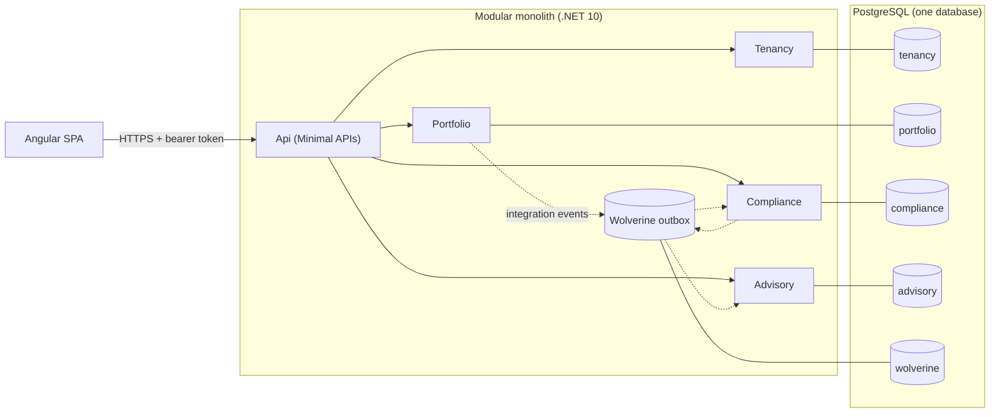

# FinGuard

An entity uploads a CSV with its investment portfolio at a cut-off date. FinGuard validates it, evaluates it against
global maximum-allocation limits per asset class (`cash`, `fixed_income`, `shares`, `real_estate`; all in USD) on
**book value** ([ADR-0010](docs/adr/0010-valuation-basis-book-value.md)), returns `compliant` / `warning` /
`breached`, raises alerts near the limits and produces a rebalancing advisory: a deterministic proposal explained by
an AI narrative. It is a portfolio project built local-first, at near-zero cost until the Azure phase.

## Status

| Phase | State | Scope |
| --- | --- | --- |
| 0 Foundations | ✓ Done | Solution skeleton, Aspire, PostgreSQL, module DbContexts, Wolverine outbox, CI |
| 1 Walking skeleton | ✓ Done | Development login, tenant resolution, Angular shell, file upload and submission history end to end |
| 2 Portfolio ingestion | ✓ Done | CSV validation, rejected files with errors, idempotent uploads, current submission per cut-off date, `SubmissionAccepted` event to Compliance |
| 3 Compliance | In progress | Done: domain model and versioned global limit policy with its seed ([ADR-0012](docs/adr/0012-compliance-domain-model.md)). Next: evaluation on `SubmissionAccepted`, result API and UI, then the rebalance proposal |
| 4 Advisory | Planned | AI narrative behind `IAdvisoryNarrator`, deterministic fallback |
| 5 Azure | Planned | Container Apps, Static Web Apps, Entra External ID, Key Vault, observability |

Event flow today: an accepted upload publishes `SubmissionAccepted` (class totals) through the outbox in the same
transaction, and Compliance stores its own portfolio snapshot from it ([ADR-0011](docs/adr/0011-portfolio-compliance-integration-contract.md)).

Every decision is recorded in the [decisions log](docs/decisions.md) (append-only).

## Architecture at a glance



- **Modular monolith with vertical slices**: one schema and DbContext per module, references only through
  `*.Contracts` ([ADR-0001](docs/adr/0001-modular-monolith-vsa.md)).
- **Wolverine with a PostgreSQL transactional outbox** for commands and integration events
  ([ADR-0003](docs/adr/0003-wolverine-messaging-outbox.md), [ADR-0009](docs/adr/0009-module-messaging-conventions.md)).
- **Tenant isolation**: `tenant_id` on every tenant-owned row, EF query filters, tenant only from the token
  ([ADR-0004](docs/adr/0004-multi-tenancy.md)).
- **EF Core for commands, Dapper for queries** with a mandatory `tenant_id` filter
  ([ADR-0007](docs/adr/0007-persistence-ef-commands-dapper-queries.md)).
- **Deterministic engine, AI narrator**: the model never computes amounts or decides compliance
  ([ADR-0002](docs/adr/0002-deterministic-engine-ai-narrator.md), [ADR-0006](docs/adr/0006-ai-stack-agent-framework.md)).
- **Local-first, Azure in Phase 5** ([ADR-0005](docs/adr/0005-local-first-cloud-ready.md)); development identity
  until then ([ADR-0008](docs/adr/0008-development-identity.md)).
- **Book value** is the valuation basis for limits ([ADR-0010](docs/adr/0010-valuation-basis-book-value.md)).

More diagrams: [architecture overview](docs/architecture/overview.md).

## Try it in two minutes

Prerequisites (Windows: .NET 10 SDK, Docker Desktop, Node 24 LTS with pnpm, Aspire CLI as a .NET global tool):
[development environment](docs/dev-environment.md).

```powershell
dotnet tool restore
aspire run            # Git Bash: aspire.cmd run
```

1. Open the dashboard URL printed on start, then the `web` resource URL.
2. Sign in as **Alice** (Acme Pension Fund).
3. Upload the files from [`samples/portfolios/`](samples/portfolios/README.md) with any cut-off date up to today:
   - `valid-balanced.csv`: accepted, 9 positions, marked **Current** for its date.
   - `invalid-mixed.csv`: rejected; the detail page lists its 9 errors by row and column.
   - The same file again for the same date: "Already uploaded on …"; nothing new is stored.
   - Another valid file for the same date: it becomes the current one; the older one stays in the history.
4. Sign in as **Bob** (Globex Insurance): Alice's submissions are not visible.

## Quality

| Suite | Command | Tests |
| --- | --- | --- |
| Backend unit | `dotnet test --project tests/FinGuard.UnitTests` | 187 |
| Backend integration (Testcontainers PostgreSQL, Docker required) | `dotnet test --project tests/FinGuard.Api.IntegrationTests` | 107 |
| Architecture | `dotnet test --project tests/FinGuard.ArchitectureTests` | 15 |
| Frontend (Vitest) | `pnpm test` in `src/frontend/finguard-web` | 73 |
| End to end (Playwright, against `aspire run`) | `$env:E2E_BASE_URL = '<web url>'; pnpm e2e` | 4 |

Counts as of Brief #11 (2026-11-20). Architecture tests enforce module boundaries, tenant rules and messaging
conventions by convention-based discovery. Banned APIs (for example `IgnoreQueryFilters` and `DateTime.UtcNow`) fail
the build through `src/backend/BannedSymbols.txt` (RS0030). CI runs format, build, tests, lint and the frontend build
on every pull request.

## Repository map

```
src/backend/          Api, AppHost, ServiceDefaults, BuildingBlocks, Modules/<Module>(+ .Contracts)
src/frontend/         Angular app (finguard-web), Playwright E2E in e2e/
tests/                unit, integration and architecture tests
samples/portfolios/   sample CSV files with their expected outcomes
docs/                 ADRs, architecture, decisions log, briefs, workflow guides
scripts/              dev-session.ps1 (session snapshot, Aspire start and stop)
.claude/ .cursor/     path-scoped rules for AI coding agents
```

## Working with AI agents

- `AGENTS.md`: shared rules for every agent (Claude Code, Cursor). `CLAUDE.md`: Claude Code specifics.
- `.claude/rules/` and `.cursor/rules/`: the same path-scoped rules for both tools
  ([AI rules guide](docs/ai-rules.md)).
- `docs/briefs/`: one brief per pull request. The agent presents a plan, waits for approval, works on its own branch
  and stops after local commits; the owner reviews, pushes and merges.
- Every session closes what it opened: `scripts/dev-session.ps1 -Snapshot` first, Aspire only via `-StartAspire`,
  `-Stop` before the final message, and a close-out block ("Still running: none").

## Documentation

- [Architecture decision records](docs/adr/README.md)
- [Architecture overview](docs/architecture/overview.md)
- [Decisions log](docs/decisions.md)
- [CI/CD](docs/ci-cd.md)
- [Git workflow](docs/git-workflow.md)
- [Development environment](docs/dev-environment.md): prerequisites, shells, closing a session, resetting the dev
  database
