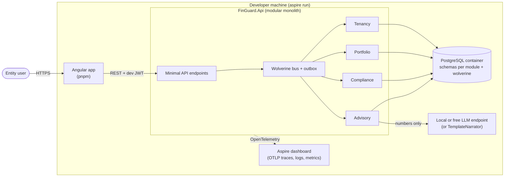
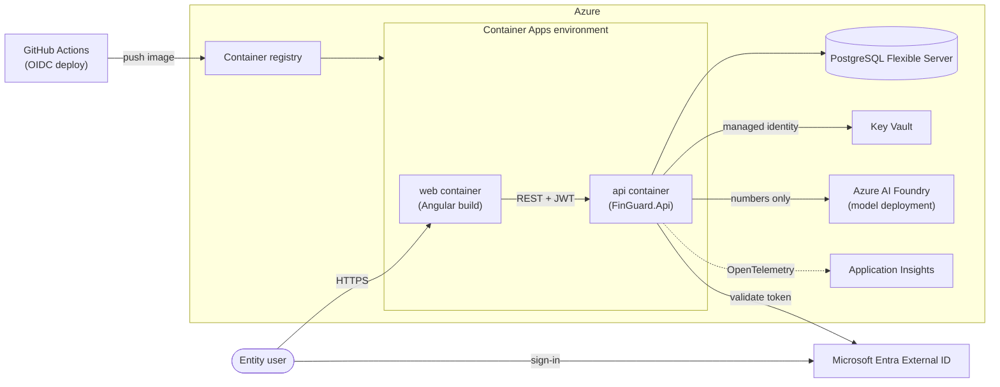
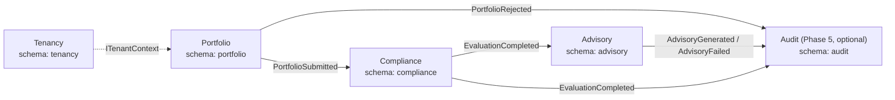
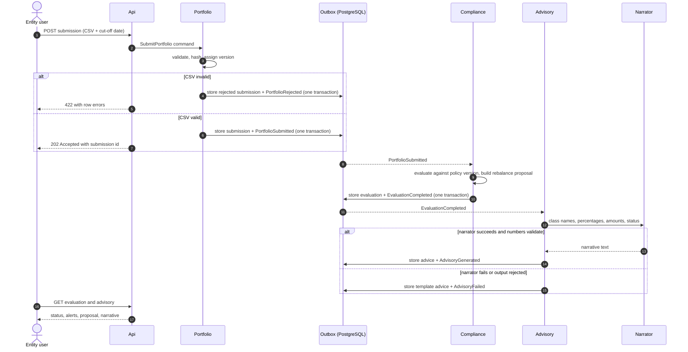

# FinGuard architecture overview

Diagrams use Mermaid and render on GitHub. Decisions behind them are in `docs/adr/`.

## 1. Containers: local (Phases 0 to 4)

Everything runs on the developer machine, orchestrated by the Aspire AppHost. See ADR-0005.

## 2. Containers: Azure target (Phase 5)

Same code, different configuration. Deployed on demand and torn down after demos.

## 3. Module dependencies and events

Modules never reference each other's internals. Arrows are integration events through the Wolverine outbox, except
the dashed line, which is the `ITenantContext` abstraction from BuildingBlocks.

## 4. Event flow for one submission

`PortfolioSubmitted` carries the class totals so Compliance never calls back into Portfolio. Delivery is at-least-once,
so consumers are idempotent.

