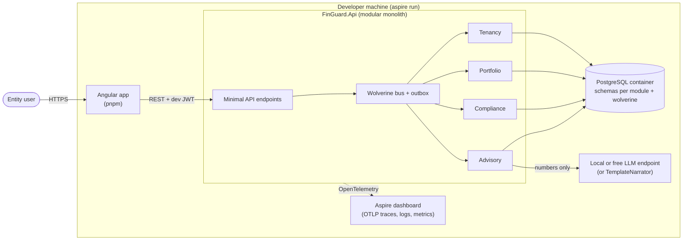
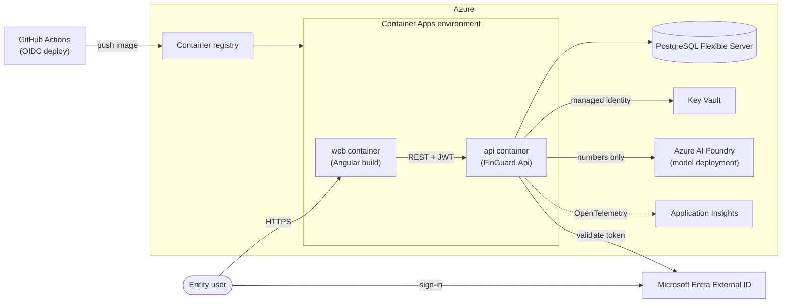
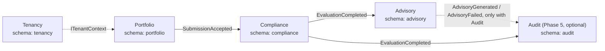

# FinGuard architecture overview

Diagrams use Mermaid and render on GitHub. Decisions behind them are in `docs/adr/`.

## 1. Containers: local (Phases 0 to 4)

Everything runs on the developer machine, orchestrated by the Aspire AppHost. See ADR-0005.



## 2. Containers: Azure target (Phase 5)

Same code, different configuration. Deployed on demand and torn down after demos.



## 3. Module dependencies and events

Modules never reference each other's internals. Arrows are integration events through the Wolverine outbox, except
the dashed line, which is the `ITenantContext` abstraction from BuildingBlocks.



## 4. Event flow for one submission

`SubmissionAccepted` (ADR-0011) carries the book-value total per asset class, so Compliance never calls back into
Portfolio. It is published once per new accepted submission, in the same transaction; rejected and duplicate uploads
publish nothing. Delivery is at-least-once, so Compliance stores its `portfolio_snapshots` row idempotently by
`EventId`. A new snapshot cascades the internal command `EvaluatePortfolio`, which runs in its own transaction: it
evaluates the snapshot against the limit policy in force at the cut-off date, stores one evaluation per submission with
its policy snapshot and cascades `EvaluationCompleted` (D-192, D-193). The received fact and the derived result commit
separately, so a failed evaluation can be replayed from the error queue without losing the snapshot. The Api reads
the result with `GET /api/v1/compliance/submissions/{id}/evaluation` (D-197).

Advisory subscribes to `EvaluationCompleted` (ADR-0014). It builds `AdvisoryFacts` (the event's numbers plus their
display texts), writes the narrative with the `TemplateNarrator`, checks it with `NarrativeValidator` and stores it,
idempotent by `EventId`. `GET /api/v1/advisory/submissions/{id}/advisory` returns the paragraphs. Evaluations stored
before Advisory subscribed have no advisory (R-40, closed without backfill). Advisory publishes `AdvisoryGenerated`
and `AdvisoryFailed` only if the optional Audit module is built (D-259).

When a narrator model is configured (ADR-0015), the template advisory is stored as `Pending` and the same transaction
cascades `RefineNarrative`. That step runs on its own queue (`advisory-refinement`, one message at a time) in a handler
without a DbContext, so no transaction is open during the model call. It asks one Agent Framework agent (no tools) for
one context paragraph from class names only, normalizes it, validates it (no digits, no amount or percent words, no
status wording, plain text, one paragraph of 150 to 700 characters) and cascades `StoreRefinedNarrative`, which sets
`ai_context` only while the advisory is still `Pending`. The template narrative is never replaced (D-293). A timeout, a
model error or a failed check adds nothing and records the reason; nothing goes to the error queue. The model is off by
default (`dev-session.ps1 -StartAspire -WithAi` opts in).

The upload validates synchronously (D-111, D-112). Transport problems (no file, empty, over 5 MB, not `.csv`, bad,
future or pre-2000 cut-off date) return 400/413 and store nothing. Otherwise the submission is always stored and the Api answers
`201 Created` with `status` `Accepted` (positions stored) or `Rejected` (first 100 errors stored, `errorCount` holds the
total). There is no 422 or 202 for uploads.

Uploads are idempotent (D-139): the same file (SHA-256 of the raw bytes) for the same cut-off date returns the earliest
existing submission with `200 OK` and `duplicate: true`, and nothing is stored or published. Among a tenant's accepted
submissions for a date, the latest by `received_at` is the current one (D-141), computed when reading.

```mermaid
sequenceDiagram
  autonumber
  actor U as Entity user
  participant API as Api
  participant P as Portfolio
  participant OB as Outbox (PostgreSQL)
  participant C as Compliance
  participant A as Advisory
  participant N as Narrator

  U->>API: POST submission (CSV + cut-off date)
  API->>P: ReceiveSubmission command
  alt transport problem (empty, too large, not .csv, bad, future or pre-2000 date)
    API-->>U: 400/413 problem, nothing stored
  end
  P->>P: hash the file
  alt same hash and cut-off date already stored
    API-->>U: 200 OK, duplicate, existing submission (nothing stored)
  end
  P->>P: read and validate the CSV
  alt CSV invalid
    P->>P: store Rejected submission + errors (no event)
    API-->>U: 201 Created, status Rejected, errors
  else CSV valid
    P->>OB: store Accepted submission + positions + SubmissionAccepted (one transaction)
    API-->>U: 201 Created, status Accepted
  end
  OB-->>C: SubmissionAccepted (durable local queue)
  C->>OB: store portfolio snapshot (idempotent by EventId) + EvaluatePortfolio
  OB-->>C: EvaluatePortfolio (durable local queue)
  C->>C: evaluate against the policy version in force at the cut-off date + rebalance proposal (ADR-0013)
  C->>OB: store evaluation with proposal + EvaluationCompleted (one transaction, once per submission)
  OB-->>A: EvaluationCompleted (durable local queue)
  A->>A: AdvisoryFacts (numbers and display texts, no free text)
  A->>N: TemplateNarrator
  N-->>A: plain-text paragraphs
  A->>A: NarrativeValidator: every number comes from the facts
  A->>OB: store advisory (idempotent by EventId; Pending + RefineNarrative when a model is configured)
  opt model switched on (ADR-0015, off by default), outside any transaction
    OB-->>A: RefineNarrative (advisory-refinement queue, one at a time)
    A->>N: AgentFrameworkNarrator over the local model, with a timeout
    N-->>A: one context paragraph
    A->>A: AiContextValidator: no digits, symbols or status wording; plain text; one paragraph
    A->>OB: StoreRefinedNarrative: ai_context, or nothing added with a reason
  end
  U->>API: GET evaluation and advisory
  API-->>U: status, alerts, proposal, narrative, its source
```
